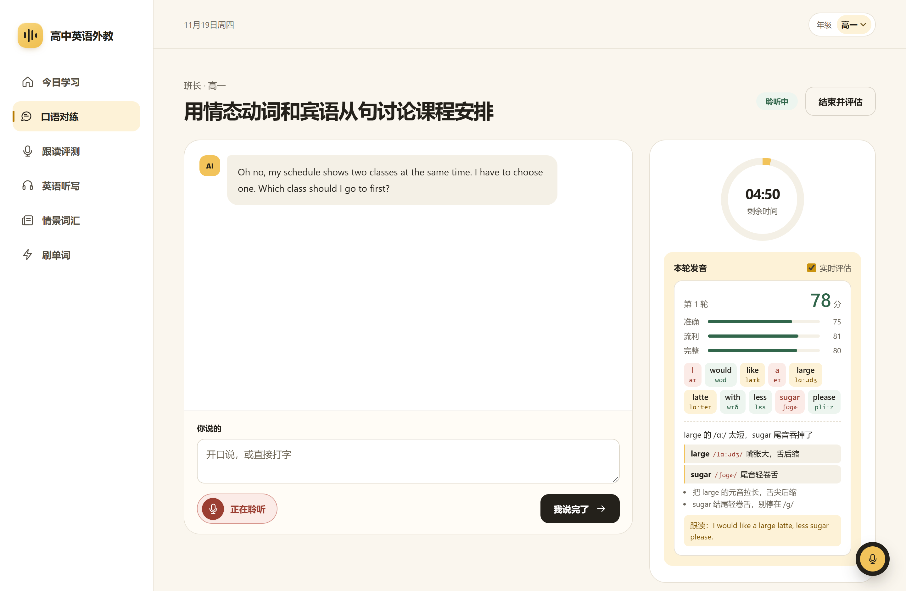
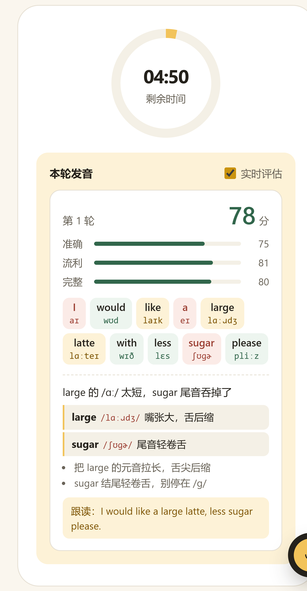

# AI 英语外教 · 高中英语口语陪练

一个可以本地部署的英语口语陪练 Web 应用：学生选一个校园情景，跟 AI 外教进行**语音情景对话**；外教的话由大模型现场生成、TTS 朗读；学生说完后，本地声学模型给出**逐词音标级发音分**，同时有独立的语法点评、中文翻译和结课英语画像。

> 本仓库只包含**源码**：不含任何模型权重、不含第三方依赖二进制、不含 API Key 与私有接口地址。按下面的步骤自备模型和凭据即可运行。





---

## 1. 功能

| 模块 | 说明 |
|---|---|
| AI 外教对话 | 按年级（高一 A2 / 高二 B1 / 高三 B1+）控制语言难度；一次只在角色内说 1–2 句，再抛一个问题 |
| 情景生成 | 9 个预设校园情景 + 自定义情景，每次现场生成开场白，避免重复 |
| 对话记忆 | 把整场对话（按字符预算截断）带回上下文，能记住人名、地点、已答过的问题 |
| 自适应辅导 | 连续语法错误 → 点名并给正确说法；连续发音偏低 → 放慢、拆句带读；连续表现优秀 → 具体表扬并加难度 |
| 发音评测 | 本地 Wav2Vec2 音素模型 + espeak-ng 音标，逐词给分与弱音素，完全离线 |
| 语法点评 | 独立于对话的语法分析：分数、问题片段、正确写法、整句改写 |
| 翻译 | 外教英文回复下方补一行中文，说完再补，不拖慢开口 |
| 结课画像 | 语法 / 时态搭配 / 流利度 / 发音四维，数字来自实测而非模型编造 |
| 背单词 | 三向刷词、错词进复习队列、支持拍照听写批改 |
| 模型热切换 | 顶栏按钮在云端对话模型与本地 Ollama 模型之间切换，无需重启 |

---

## 2. 架构

```
浏览器（原生 JS + Web Audio）
   │  PCM 音频 / 文本  ▲ PCM 音频 / 字幕
   ▼                  │
主站 FastAPI (8765) ──┴── WebSocket /api/ws/conversation
   ├─ 对话编排：轮次切分、上下文拼装、辅导策略
   ├─ 语法点评 / 翻译 / 报告（OpenAI 兼容对话模型）
   ├─ 语音识别 + 语音合成（可选云服务；缺失时回退浏览器能力）
   └─ 评分调度 ──► 本地评测服务 FastAPI (8010)
                       └─ Wav2Vec2 音素识别 + espeak-ng → 逐词音标与分数
```

目录：

```
.
├─ app/                    主站
│  ├─ run.py               入口（有证书自动 HTTPS）
│  ├─ backend/             对话编排、模型客户端、语音服务适配、评分调度
│  ├─ static/              页面、样式、对话脚本
│  ├─ tests/               单元测试
│  └─ .env.example         配置模板
├─ scorer/                 本地逐词发音评测服务（独立进程，CPU 推理）
│  ├─ serve.py             只保留评分能力的极简服务
│  └─ app/                 音素评分、对齐、音标后端
├─ tools/
│  ├─ launcher.py          同时拉起两个服务、写日志
│  └─ selfcheck.py         环境自检
├─ models/                 （空）放音素模型权重，见 models/README.md
├─ requirements.txt
├─ start.bat / stop.bat / selfcheck.bat
└─ docs/ARCHITECTURE.md    更细的流程与时序说明
```

两个服务**分进程**是刻意的：评分需要独立的重型推理栈，且评测慢不能阻塞外教开口。评测在独立任务里跑，结果只补侧栏。

---

## 3. 快速开始

### 3.1 环境

| 项 | 要求 |
|---|---|
| 系统 | Windows 10/11 / macOS / Linux |
| Python | 3.10+（3.12 已验证） |
| 内存 | 建议 8 GB 以上 |
| 磁盘 | 源码约 1 MB；模型权重另计（通常 1–2 GB） |
| 网络 | 云端对话模型与语音服务需要联网；**发音评分完全离线** |

### 3.2 安装依赖

```bash
python -m venv .venv
# Windows
.venv\Scripts\activate
# macOS / Linux
source .venv/bin/activate

pip install -r requirements.txt
```

### 3.3 准备发音评测

1. **音素模型**：把任意兼容的 Wav2Vec2 音素分类模型（`Wav2Vec2ForCTC`，词表为 IPA 音素）放到 `models/phoneme-model/`，目录内需有 `config.json` 与权重文件。也可以把 `PHONEME_MODEL_PATH` 指向 Hugging Face 模型 ID，由 `transformers` 自行下载。
   > 本仓库不分发权重，请遵守所选模型的许可证。
2. **espeak-ng**：用于生成词典音标。安装系统版 espeak-ng，或把便携版放到 `tools/espeak/`（需要 `libespeak-ng.dll` 与 `espeak-ng-data/`），再用 `ESPEAK_ROOT` 指定。
3. 不想启用评分：`.env` 里设 `SPEECH_EVAL_PROVIDER=demo`，侧栏会明确显示"未评分"，不会伪造分数。

### 3.4 配置

```bash
cp app/.env.example app/.env
```

最少需要填一个对话模型的地址与 Key；语音识别/合成不填时会自动回退到浏览器的 Web Speech 能力。

### 3.5 启动

```bash
# 一次拉起两个服务并打开浏览器
python tools/launcher.py start

# 停止
python tools/launcher.py stop
```

Windows 也可以直接双击 `start.bat` / `stop.bat`。默认地址：

- 主站：`http://127.0.0.1:8765`（`app/certs/` 下放了证书则自动变 HTTPS）
- 评测：`http://127.0.0.1:8010`

### 3.6 自检

```bash
python tools/selfcheck.py
```

逐项检查依赖、模型、espeak、两个服务的健康状态，并真的发一段音频去要分数。

---

## 4. 配置项

全部通过环境变量或 `app/.env` 提供，**密钥只留在服务端**，前端 JS 不读取任何凭据。

| 变量 | 作用 |
|---|---|
| `LLM_PROVIDER` | 启动时默认使用 `deepseek`（云端）还是 `qwen`（本地） |
| `DEEPSEEK_BASE_URL` / `DEEPSEEK_API_KEY` | 任意 OpenAI Chat Completions 兼容服务的地址与 Key |
| `DEEPSEEK_VISION_MODEL` | 对话、语法、翻译、报告共用的模型名（填你账号可用的模型） |
| `QWEN_BASE_URL` / `QWEN_MODEL` / `QWEN_API_KEY` | 本地 Ollama 的 OpenAI 兼容接口 |
| `DOUBAO_API_KEY` / `DOUBAO_ASR_WS_URL` / `DOUBAO_ASR_RESOURCE_ID` | 流式语音识别（可选） |
| `DOUBAO_TTS_WS_URL` / `DOUBAO_TTS_RESOURCE_ID` / `DOUBAO_TTS_VOICE` | 流式语音合成（可选） |
| `SPEECH_EVAL_PROVIDER` | `local` 本地逐词 / `xfyun` 讯飞 ISE / `demo` 不评分 |
| `LOCAL_PRONOUNCE_URL` | 评测服务地址，默认 `http://127.0.0.1:8010` |
| `PHONEME_MODEL_PATH` / `ESPEAK_ROOT` | 音素模型与 espeak-ng 的位置 |
| `PRON_FEEDBACK` | 是否让教练分析发音（`on` / `off`） |
| `XFYUN_APP_ID` / `XFYUN_API_KEY` / `XFYUN_API_SECRET` / `XFYUN_ISE_HOST` | 讯飞 ISE 评测（可选） |

> 变量名里的 `DEEPSEEK_` / `DOUBAO_` / `QWEN_` 只是历史命名，实际可指向任何兼容服务。

---

## 5. 发音评分怎么算

```
录音 ──► 识别文本（同时作为评分标准答案）
          │
          ├──► 评测服务：espeak-ng 给每个词生成 IPA
          │              Wav2Vec2 + CTC 在音素级打分
          │              ──► 逐词分数 / 音标 / 弱音素
          │
          └──► 外教（对话模型，继续角色扮演）
                   ▲
        逐词结果 ──► 发音教练（独立提示词，只谈发音）
```

- 分数 = 准确度 × 0.5 + 流利度 × 0.3 + 完整度 × 0.2；
- 侧栏按绿 ≥85 / 黄 65–84 / 红 <65 着色；
- 虚词（`a / an / the / of / to`）词典音标是强读式，真人多读弱读式，分数天然偏低，因此不参与重读建议，也不喂给教练；
- 双元音滑音段同样不参与弱音素提示。

---

## 6. 对话辅导策略

一轮只做一件事，优先级：

1. **听不懂**（说"没听懂"、用中文回答）→ 逐句讲解 + 更简单的英文 + 一个两三个词就能回答的问题；
2. **语法问题** → 一句中文点出问题 + 正确英文 + 顺势把场景推进；
3. **发音问题** → 表扬 + 点名那个词 + `Repeat after me: …` + 场景提问；
4. **表现优秀** → 具体表扬用对的结构 + 更难的 why/how 追问。

连续性问题会升级处理：同类语法错误连续两轮出现会点明"这是习惯"，发音连续两轮偏低会放慢并拆句带读，连续两轮都稳则给出具体表扬。

---

## 7. 主要接口

| 方法 | 路径 | 说明 |
|---|---|---|
| GET | `/api/health` | 各能力就绪状态（含当前模型） |
| GET/POST | `/api/llm` | 查询 / 切换对话模型 |
| GET | `/api/content?topic=&grade=` | 情景、词库内容 |
| POST | `/api/conversation/session` | 创建会话 |
| POST | `/api/conversation/{id}/turn` | 追加一轮 |
| POST | `/api/conversation/{id}/finish` | 结束并生成报告 |
| POST | `/api/pronunciation/evaluate` | 单句发音评测 |
| POST | `/api/dictation/photo` | 拍照听写批改（需多模态模型） |
| WS | `/api/ws/conversation` | 对话主通道：音频上下行、字幕、评分事件 |
| WS | `/api/ws/asr` | 纯识别通道 |
| GET/POST | `:8010/api/health`、`:8010/api/oral/score` | 本地评测服务 |

---

## 8. 本仓库不包含什么

为了避免体积和授权问题，以下内容**刻意没有提交**，需要使用者自行准备：

- **模型权重**（音素模型、任何对话模型）——不随仓库分发；
- **第三方依赖与二进制**（虚拟环境、便携解释器、espeak-ng 二进制、DLL）；
- **任何 API Key、Token、账号信息**；
- **私有服务域名与资源 ID**——配置模板里全部是占位符；
- 运行期数据（会话记录、录音、日志、证书、本地模型状态）。

`.gitignore` 已覆盖上述路径；提交前仍建议执行一次密钥扫描。

---

## 9. 第三方组件与许可

| 组件 | 用途 | 许可提示 |
|---|---|---|
| FastAPI / Uvicorn | Web 服务 | MIT / BSD |
| PyTorch / TorchAudio | CPU 推理 | BSD 风格 |
| Transformers | 加载音素模型 | Apache-2.0 |
| espeak-ng | 生成 IPA | GPL-3.0（**未随仓库分发二进制**，请自行安装并遵守其许可） |
| SoundFile / libsndfile | 音频读写 | BSD / LGPL |
| phonemizer | 音标接口 | GPL-3.0 |
| SQLAlchemy / Pydantic | 数据与校验 | MIT |
| 词库 | 词汇内容 | 见 `THIRD_PARTY_LICENSES/word-forest-LICENSE.txt` |

使用或分发前，请自行确认所选模型权重与语音服务的许可证和商用条款。

---

## 10. License

源码许可**待定**：仓库作者需在发布前补充 `LICENSE` 文件（例如 MIT 或 Apache-2.0）。第三方组件与模型各自遵循其原许可，见上一节。
